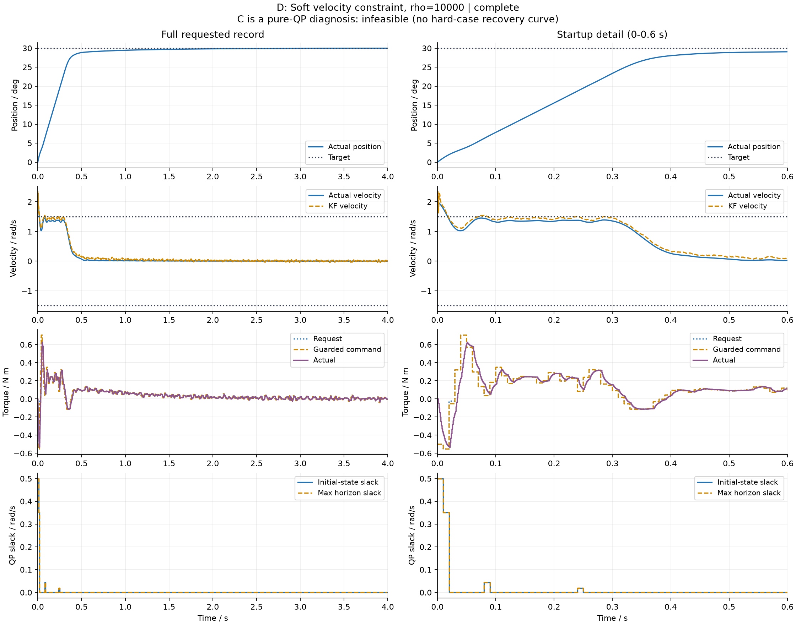
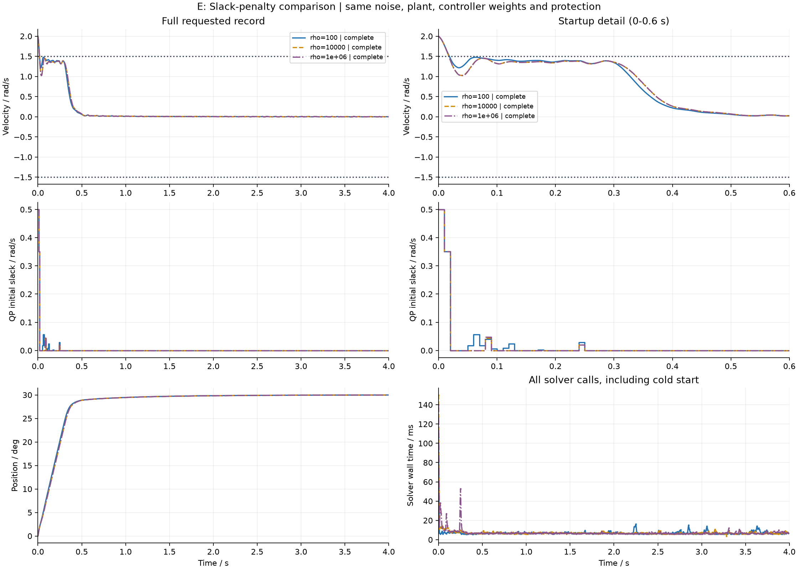

# 第13课C/D/E：不可行、速度软约束与惩罚权重

本报告由真实仿真运行生成，不是实机测量。F/G超时降级与fallback尚未实现。

## C：为什么硬约束不可行

本次C/D/E显式约束x0..xN。初始速度已知为2 rad/s，却要求当前速度绝对值不超过1.5 rad/s；不能靠未来扭矩改变已经发生的初值。
硬组原始状态：infeasible；纯QP诊断，不存在可执行的C闭环恢复轨迹。完整返回值见../logs/feasibility_diagnostic.json。

## D：松弛量怎样进入代码

`lower - EPS <= X[1, indices] <= upper + EPS; EPS >= 0`

`cost = original_cost + S*sum(DU**2) + rho*sum(EPS**2)`

软化的是速度边界，不是扭矩、变化量或位置。EPS单位rad/s，rho表示每单位速度松弛平方的代价尺度，与S的扭矩变化量平方尺度不同；数值大小不能直接比较。
同一静态输入soft状态：optimal；首列EPS0=0.5 rad/s（由初值至少需要0.5）。
mpc_controller.py构造期创建EPS并追加不等式；solve复核索引、非负性、软边界及全部硬边界。EPS不是从真实速度中减去的修正量。
为改善数值尺度，整个soft目标除以max(1,rho)，不改变相对权重或数学最优解；导出objective恢复原单位。容差仍为1e-5，不靠放宽验收制造成功。

## 实验条件与信息边界

|参数|本次有效值|
|---|---|
|物理/KF周期|1 ms|
|MPC周期|10 ms|
|预测步数|20|
|扭矩幅值|±2 N·m|
|位置边界|±60°|
|速度边界|±1.5 rad/s|
|初始速度|2 rad/s|
|实际变化率上限|50 N·m/s|
|QP变化量边界|±0.5 N·m|
|执行器延迟/时间常数|2/5 ms|
|库仑摩擦|0.12 N·m|

同一预生成编码器噪声，KF只使用位置测量及过去区间实际扭矩；预测为两状态线性模型。摩擦和执行器动态未进入预测模型。扭矩反馈仍是假设准确同步的驱动器反馈。
位置独立越界监测启用，主实验不额外注入随机扰动力矩。Q/R/P及S=.5固定，D的rho=1e4，E只改rho。配置/版本/终态和原始CSV/NPZ均保存在logs。

## 实测指标

|Case|Status|覆盖/s|位置RMSE/rad|真实超速峰值/(rad/s)|真实超速积分/rad|QP初始slack持有积分/rad|平均迭代|墙钟p95/ms|失败次数|
|---|---|---:|---:|---:|---:|---:|---:|---:|---:|
|d_soft|complete|4|0.0940742|0.5|0.00537173|0.00914367|84.8125|8.96694|0|
|e_rho100|complete|4|0.0918212|0.5|0.00544067|0.0105281|63.8125|9.52894|0|
|e_rho10000|complete|4|0.0940742|0.5|0.00537173|0.00914367|84.8125|9.16656|0|
|e_rho1e6|complete|4|0.0941317|0.5|0.00537017|0.00917211|136.438|9.06956|0|

## 本次权重取舍

rho从10000增至1e+06，真实超速积分从0.0053717271变为0.005370168 rad；位置RMSE从0.094074194变为0.094131734 rad；平均迭代从84.8125变为136.438。这些数值仅对应本次配置，不代表所有工况。
rho惩罚的是每次QP整个预测时域的slack平方和；表中的初始slack持有积分是闭环过程中另一种线性统计量，初值/轨迹也随控制变化，所以它不必随rho单调下降。计时未隔离主机负载，不能把墙钟差异直接归因于rho，更不是F的受控性能基准。

## 图与结论怎样看

D左列保留全程，右列放大启动段。速度实线是真值、虚线是KF；扭矩分别是请求、保护后命令和实际输出。slack只在控制事件记录，不等于真实超速。

E前三组使用同一噪声，仅rho变化。速度/slack分别显示全程和启动段；最后一行显示位置和完整求解墙钟记录（包含首轮编译开销），平均迭代见表。失败轨迹在停止时刻截断，不填补成恢复曲线。
真实超速积分按已施加输入的1ms物理区间计算；QP初始slack持有积分按控制事件持有区间计算，并在末尾/失败时截断。最大预测slack及其完整计划见NPZ。最终状态单独保存，不额外增加积分区间。
当前速度初始2、边界±1.5，所以各组起点的真实超速至少0.5；不能仅比较这个峰值就判断rho有效性。应继续看超速持续时间/积分、slack、跟踪与数值求解表现。
有限二次惩罚可能在可行时仍使用少量slack，也不保证最终严格为零。rho更大并不保证每项真实指标单调改善：估计误差、未建模执行器和数值条件都会影响结果。
D与E名义rho组重复运行用于一致性校验，不是独立随机重复实验。结果仅对应当前种子/模型；不构成实机速度安全或硬实时保证。

## 阅读代码顺序

先看mpc_controller.py的velocity_indices/EPS构造，再看closed_loop.py的控制事件slack记录，最后看feasibility_metrics.py为何区分两种积分。run_feasibility.py负责公平分组、导出和画图。

后续F/G才处理预算、fallback和恢复；软化速度不能修复其他硬约束冲突。
