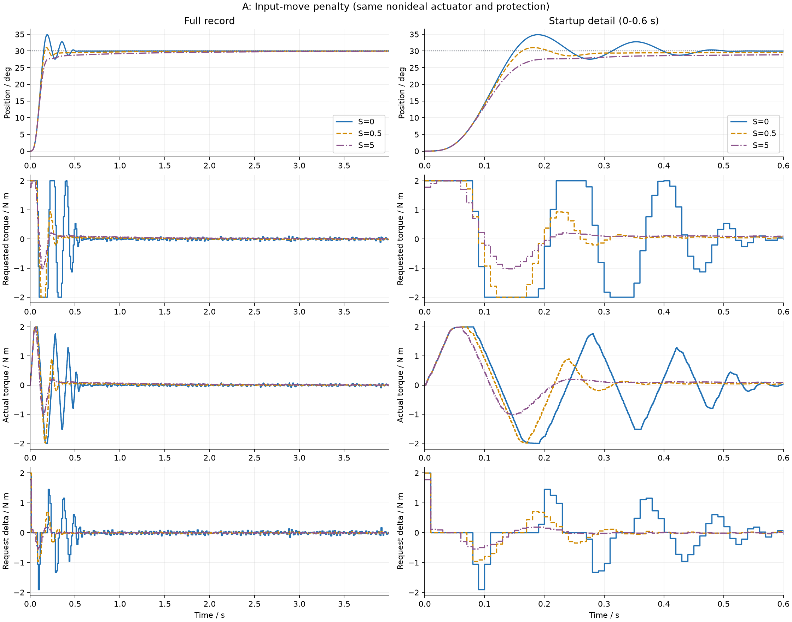
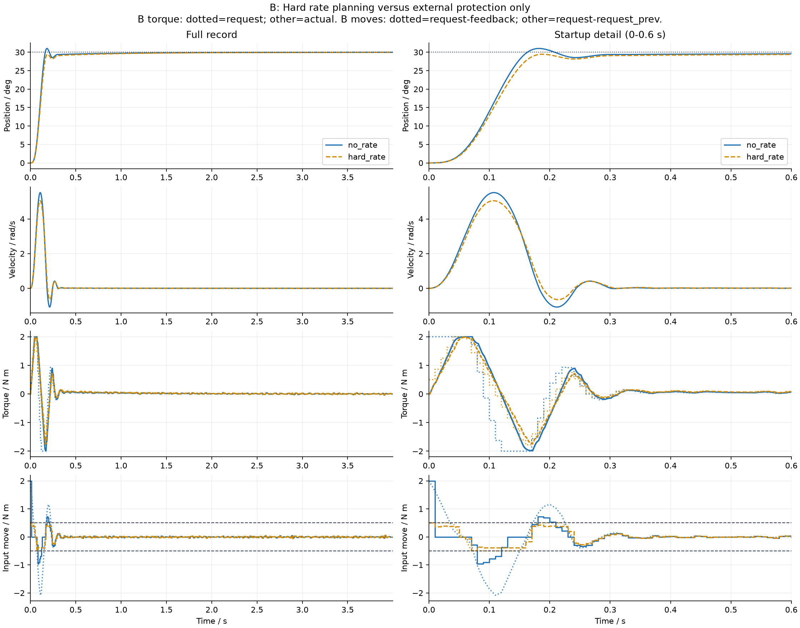

# 第13课实验A/B：输入变化量

本文件由运行入口按实际结果生成。不是实机测量；软约束、预算降级和综合验收尚未实现。

## 设置与公式

`J = sum(e.T Q e + u.T R u + S * delta_u²) + e_N.T P e_N`；
`delta_u[0] = U[0] - previous_actual_feedback`，后续为相邻规划输入之差。
S是代价，不能保证硬边界；B硬约束为每10 ms最多0.5 N·m（默认配置）。

同一名义模型、KF、参考、噪声实现、执行器和外部保护。Q/R沿用第12课Bryson尺度，P是旧课固定终端权重，未声称是变化量增广系统的最优终端权重。
对象有库仑摩擦；执行器有延迟、滞后和真实变化率限制，预测仍是两状态线性模型，存在显式失配。扭矩反馈暂按无噪声同步驱动器反馈假设。
速度约束在本阶段关闭，位置未来硬边界与真实越界监测启用；不宣称真实位置安全保证。

完整配置和库版本见 `../logs/experiment_ab_summary.json`，每组CSV和计划NPZ可复核。

## 实测结果

| Case | Status | Position RMSE/rad | Actual torque RMS/Nm | Request delta RMS/Nm | Request delta max/Nm | QP first delta max/Nm | Guard changes |
|---|---|---:|---:|---:|---:|---:|---:|
| a_s0 | complete | 0.076080 | 0.423209 | 0.258466 | 2.000000 | 3.198091 | 36 |
| a_s0p5 | complete | 0.075707 | 0.322300 | 0.151166 | 2.000000 | 2.084525 | 14 |
| a_s5 | complete | 0.077610 | 0.251747 | 0.107997 | 1.781376 | 1.781376 | 5 |
| b_no_rate | complete | 0.075707 | 0.322300 | 0.151166 | 2.000000 | 2.084525 | 14 |
| b_hard_rate | complete | 0.077228 | 0.286064 | 0.093801 | 0.500000 | 0.500000 | 0 |

## 本次数据的结论

- a_s0：位置RMSE=0.076080 rad；请求变化量RMS=0.258466 N·m；外部保护修正36次。
- a_s0p5：位置RMSE=0.075707 rad；请求变化量RMS=0.151166 N·m；外部保护修正14次。
- a_s5：位置RMSE=0.077610 rad；请求变化量RMS=0.107997 N·m；外部保护修正5次。
- b_no_rate：位置RMSE=0.075707 rad；请求变化量RMS=0.151166 N·m；外部保护修正14次。
- b_hard_rate：位置RMSE=0.077228 rad；请求变化量RMS=0.093801 N·m；外部保护修正0次。

应同时比较误差与平滑度：增加S不是免费提升，平滑可能以跟踪性能为代价。硬约束组若保护修正更少，说明优化器更主动地考虑了输入变化边界；这不等于消除了执行器延迟或模型失配。

## 图与指标怎样解读

图左列保留完整4 s（默认）记录，右列放大启动0–0.6 s。A依次显示位置、请求、实际、相邻请求差；B显示位置、速度、请求/实际、两种输入差。
request_delta是相邻两次请求之差；QP首步delta是本次请求减当前反馈；有执行器滞后时两者不等。B的±0.5边界严格用于QP的DU，而不是机械套用到相邻请求差。
RMS request_delta只统计控制事件，并包含首步相对初始输入；实际变化率按1 ms物理区间计算。所有组都有外部保护，实际平滑不能单独证明规划约束生效。
比较A时同时看跟踪RMSE和请求delta，不能提前认定S增大后所有指标都单调改善。比较B时检查计划NPZ中全部DU和保护修正次数，而不只看实际扭矩。
计时包括首轮编译开销；墙钟和求解器内部计时分列在JSON中，未实施超预算切换，因此不是实时保证。失败组保留部分日志且明确标记，不能当作完整实验。

## 核心代码入口

`mpc_controller.py`扩展旧课QP；`closed_loop.py`负责过去输入/KF/控制/执行器的因果时序；`constraint_manager.py`仅负责外部命令保护；`metrics.py`区分两种采样率。

后续C/D/E研究软约束和不可行；F/G才实现计算预算与fallback。
