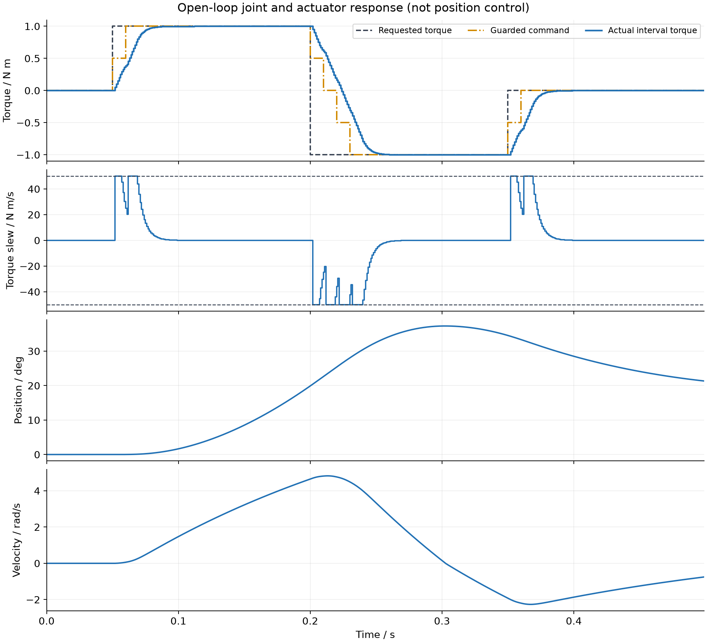

# 第一阶段：非理想对象与执行器开环演示

本阶段未实现MPC工程化闭环，完整A–G实验仍在后续阶段。本结果来自 `python -m lesson13_mpc_engineering.src.run_plant_actuator_demo`，不是实机测量。

## 条件

J=0.019762 kg·m²，b=0.080257 N·m·s/rad，库仑摩擦0.12 N·m，摩擦平滑速度0.02 rad/s。物理推进1 ms，命令更新10 ms，实际扭矩能力±2 N·m，变化率50 N·m/s，命令延迟2 ms，一阶时间常数5 ms。以上执行器数值是教学假设。

请求在0.05 s从0变+1 N·m，0.20 s变-1 N·m，0.35 s归零。命令每控制周期最多变化0.5 N·m。没有位置参考、位置反馈或负载阶跃。

## 实际记录

| 指标 | 结果 |
|---|---:|
| 实际扭矩峰值绝对值 | 1.000000 N·m（显示精度） |
| 实际扭矩变化率峰值绝对值 | 50.000000 N·m/s |
| 请求与实际扭矩最大绝对差 | 2.000000 N·m（显示精度） |
| 物理区间数量 | 500 |

0.050 s：请求1、命令0.5、实际0；0.052 s：实际开始变为0.05；0.053 s：记录到速度0.0025301083 rad/s。CSV中q/dq是区间开始状态，actual torque是推进该区间的输入，最后一行0.499 s覆盖区间至0.5 s。

第一幅图区分请求、保护后命令和实际输出。第二幅图验证实际输出的变化率边界。第三、四幅是位置与速度：请求反向后，实际扭矩不能瞬间反向，关节又有惯性，因此速度先减小再变负，位置仍可继续增加到速度过零。请求最后归零不等于位置自动回零。

这证明了后续控制器必须处理执行器输入与请求不一致；它不证明MPC优于LQR，也不证明位置/速度安全。幅值2 N·m未被此±1 N·m演示充分激活，幅值与反向边界由专门执行器测试覆盖。

## 验证

新增测试17项通过；仓库 `python -m unittest discover -v` 共117项通过，执行约54.65 s。测试覆盖动力学一步手算、旧课ZOH一致性、摩擦方向、无效输入状态保护、2 ms队列边界、滞后响应、幅值/变化率及CSV时间对齐。四联PNG已打开检查标注和布局。

下一阶段：在MPC内部加入变化量惩罚与硬变化量限制，和仅靠外部执行器保护的结果比较。

## 复核与实施决定

独立只读代码复核通过，另行运行第一阶段17项测试全部通过，未发现Critical、Important或Minor问题。

实施决定：按用户要求在main直接工作、不用worktree；Windows下以原生工具记录测试和提交而非Bash辅助脚本；增加共享数值校验模块，保持三个模块的输入规则一致。所有改动仅本地保存，未上传。风险分别为没有分支隔离、需手动维护阶段证据、共享校验的变化会影响三个模块，测试对此提供回归覆盖。

复核边界：后续MPC/KF/fallback与A–G不在本阶段；不提供硬件安全/硬实时保证；任意积分周期、极端资源规模和绕过构造器直接修改属性不在教学支持范围（无效输入及积分非有限结果仍被拒绝）。通用错误配置或日志字典不承诺友好诊断，运行入口应使用提供的YAML。没有因这些边界修改接口或新增算法，代价是使用者不能将模型当通用仿真库或实机安全模块。
