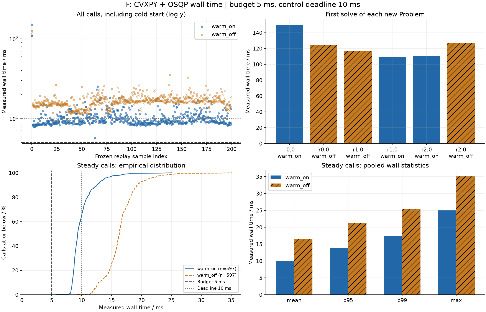
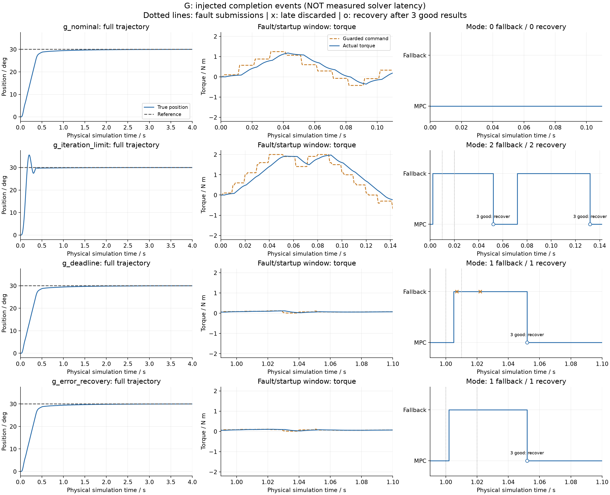

# 第13课F/G：求解预算、降级与恢复

本报告由本次实际运行生成。F是真实Python墙钟测量；G是明确注入完成时刻的确定性事件仿真。二者不能混成一张“实机实时性能”表。

## 1. 条件和边界

名义J=0.019762 kg·m²，b=0.080257 N·m·s/rad；物理/KF周期1 ms，控制周期10 ms，N=20，时长4 s，目标30°，seed=2026。
实际和命令扭矩±2 N·m，变化率50 N·m/s；QP首步相对当前实际反馈、后续相对相邻规划输入，变化量±0.5 N·m。位置未来硬边界±60°，速度未来x₁…x_N软边界±1.5 rad/s；S=0.5，rho=10000。
执行器延迟2 ms、一阶滞后5 ms；库仑摩擦0.12 N·m，平滑速度0.02 rad/s。编码器噪声标准差0.05°；过程力矩标准差0.15只用于KF协方差，本阶段没有额外随机外力。
求解预算5 ms，与控制截止10 ms不同。max_iter=4000，eps_abs=eps_rel=1e-8，独立残差容差1e-5；warm on/off均显式polishing=True。
版本：{"python": "3.11.15", "numpy": "2.4.6", "cvxpy": "1.9.3", "osqp": "1.1.3"}。完整有效配置、故障表、统计见[summary](../logs/experiment_fg_summary.json)。

## 2. 算法代码串起来

```text
编码器位置 → KF当前估计 → 参数化QP → 本轮结果/残差/时间监控
                                    ↓
                    有效且按时：MPC；否则：fresh LQR
                                    ↓
                 公共幅值/变化率保护 → 延迟/滞后执行器 → 关节
```

- `qp_solver.py`：可配置OSQP调用，保存本轮原始状态、迭代数和可取得的计时。失败不回传上轮旧解。A–E未选择新设置时仍走旧路径。
- `solver_monitor.py`：先检验状态、有限值和残差，再判断时间；`optimal`不等于可执行。连续有效且按时的结果才推进恢复计数。
- `fallback_controller.py`：固定既有LQR增益，`u_request = -K @ (x_hat-x_ref)`；每次决策重新计算，不偷看真实状态，不执行上次MPC的U。
- `managed_closed_loop.py`：一个worker、一个在途作业；先处理旧完成，再预算，再新提交。超时不假装取消求解；worker仍忙时跳过新提交并重置恢复计数。
- 恰好5 ms完成可接受，超过即丢弃；降级后连续3次有效及时结果才恢复。命令保护按距上次更新的真实事件间隔Δt限制`|Δu_command|≤slew_rate*Δt`，不一律套10 ms。
- `runtime_metrics.py`：每物理采样、每控制触发、每提交作业分母分开。`events.csv`保存同一毫秒的多次决策，避免物理CSV把事件覆盖。

## 3. F：真实求解时间

冻结200组(x_hat,x_ref,u_prev)，每个模式重复3轮；逐轮交替模式顺序，每个模式/轮只构造一次Problem。输入为人工平滑参数序列，不宣称是真实轨迹；[原序列NPZ](../logs/runtime_parameter_sequence.npz)可重放。
墙钟用perf_counter_ns，涵盖参数更新、求解、控制器独立验解，不含控制器构造；首调用含CVXPY编译/冷启动，单列不删除。计时运行没有并行跑其他性能测试。

| 模式 | 样本组 | n | mean ms | p95 ms | p99 ms | max ms | >预算/总数 | >周期/总数 | 数值有效/总数 |
| --- | --- | ---: | ---: | ---: | ---: | ---: | ---: | ---: | ---: |
| warm_on | cold | 3 | 122.906 | 145.498 | 148.636 | 149.42 | 3/3 | 3/3 | 3/3 |
| warm_on | steady | 597 | 10.0053 | 13.8252 | 17.2925 | 25.0248 | 597/597 | 211/597 | 597/597 |
| warm_on | all | 600 | 10.5698 | 13.8604 | 18.181 | 149.42 | 600/600 | 214/600 | 600/600 |
| warm_off | cold | 3 | 122.904 | 126.912 | 127.093 | 127.138 | 3/3 | 3/3 | 3/3 |
| warm_off | steady | 597 | 16.4623 | 21.1299 | 25.4463 | 35.0935 | 597/597 | 596/597 | 597/597 |
| warm_off | all | 600 | 16.9945 | 21.5895 | 26.2835 | 127.138 | 600/600 | 599/600 | 600/600 |

本次warm_on稳态p95（13.8252 ms）低于warm_off（21.1299 ms）。这只是当前机器、版本和输入序列的测量，不预设warm必然更快，也不是硬实时上界。重复轮次分列保存在summary，不把各轮p95平均冒充整体p95。
本机CVXPY公开适配源码确认：`solver_stats.solve_time`映射OSQP `info.run_time`，不能当作纯求解时间。另存`backend_solve_time_s/setup_time_s/update_time_s/run_time_s`；不可取得为null/空，不填0。warm_start=False虽然复用CVXPY Problem，CVXPY会重建OSQP后端，因此此处比较的是CVXPY的warm开关，不是纯迭代初值的隔离实验。



## 4. G：故障注入与恢复

正常完成延迟固定注入2 ms；真实solve仍调用，wall_time另存，不能用其覆盖注入完成时刻。各组使用完全相同的预生成编码器噪声。

| 场景 | 周期→故障 |
| --- | --- |
| g_nominal | `{}` |
| g_iteration_limit | `{"0": {"kind": "max_iter", "max_iter": 1}, "1": {"kind": "max_iter", "max_iter": 1}, "2": {"kind": "max_iter", "max_iter": 1}}` |
| g_deadline | `{"100": {"kind": "delay", "completion_s": 0.007}, "101": {"kind": "delay", "completion_s": 0.012}}` |
| g_error_recovery | `{"100": {"kind": "error"}, "102": {"kind": "nonfinite"}}` |

`max_iter=1`实际传给OSQP，原始返回由程序保存；error/nonfinite是明确的人为接口/数据损坏，不冒充自然发生的OSQP故障。delay只注入完成事件，不使用sleep、不冒充墙钟。

| 场景 | 状态 | 提交/周期 | 预算miss | 截止miss | 忙跳过 | 迟到丢弃 | 降级进入/恢复 | 降级s | 跟踪RMSE rad | 实际速度超限峰值 rad/s |
| --- | --- | ---: | ---: | ---: | ---: | ---: | ---: | ---: | ---: | ---: |
| f_measured_sync | complete | 400/400 | 400 | 39 | 0 | 0 | 1/0 | 4 | 0.0804349 | 4.44651 |
| g_nominal | complete | 400/400 | 0 | 0 | 0 | 0 | 0/0 | 0 | 0.106015 | 0.225417 |
| g_iteration_limit | complete | 400/400 | 0 | 0 | 0 | 0 | 2/2 | 0.11 | 0.0802431 | 4.26752 |
| g_deadline | complete | 399/400 | 2 | 1 | 1 | 2 | 1/1 | 0.047 | 0.106013 | 0.225417 |
| g_error_recovery | complete | 400/400 | 0 | 0 | 0 | 0 | 1/1 | 0.05 | 0.106013 | 0.225417 |

f_measured_sync还记录到2次未注入的数值候选失败，周期/原始状态/分类为`[(7, 'user_limit', 'iteration_limit'), (9, 'user_limit', 'iteration_limit')]`。默认迭代上限下也可能未收敛；complete表示仿真跑完，不代表每次QP成功或速度达标。

g_iteration_limit还记录到4次未注入的数值候选失败，周期/原始状态/分类为`[(7, 'user_limit', 'iteration_limit'), (8, 'user_limit', 'iteration_limit'), (9, 'user_limit', 'iteration_limit'), (10, 'user_limit', 'iteration_limit')]`。默认迭代上限下也可能未收敛；complete表示仿真跑完，不代表每次QP成功或速度达标。

注意：f_measured_sync行只表示阻塞返回后，按真实墙钟决定拒绝和降级；物理仿真并未在阻塞期间实时推进，不能从这行推出“5 ms准时切换”。G才是物理事件时序演示，也不是已经实现可抢占异步线程。



## 5. 如何独立检查与迁移实机

- 每个场景保存physical CSV、jobs JSON、events CSV、成功数值候选plans NPZ。`accepted`只表示及时有效，恢复前两次仍用LQR；`executed`表示MPC请求被选中，之后仍可能被共同guard修正，不表示实际电机扭矩等于该请求。
- `discarded`作业不得executed；`late_result_discarded`不能推进恢复。作业预算/截止计数以提交数为分母，busy以控制触发数为分母；pending保持未完成，不能伪造成功。
- 跟踪/扭矩指标是各自已观察时段的描述，不把提前终止场景并入成功平均。终态和时间单列；真实速度超限按1 ms矩形积分，峰值包含终态。位置越界独立检测后停仿真，不能称为硬件急停。
- 实机需要单调时间戳、真正的独立求解worker、带序号/有效期的结果邮箱、不可重叠的提交策略、确定的命令保护与驱动器故障处理；求解器超时不意味着OS线程已取消。
- 外层保护和LQR fallback并不保证速度/机械边界，也不使非线性饱和系统自动具有线性理论保证；还需硬件限位、看门狗、驱动级安全以及现场测试。
- 本次完成F/G；综合多seed、LQR/基础MPC/工程MPC全场景验收仍是后续阶段，不能把这两组替代综合验收。

运行：

```powershell
conda run -n robot-control python -m lesson13_mpc_engineering.src.run_experiments --experiment fg
```
